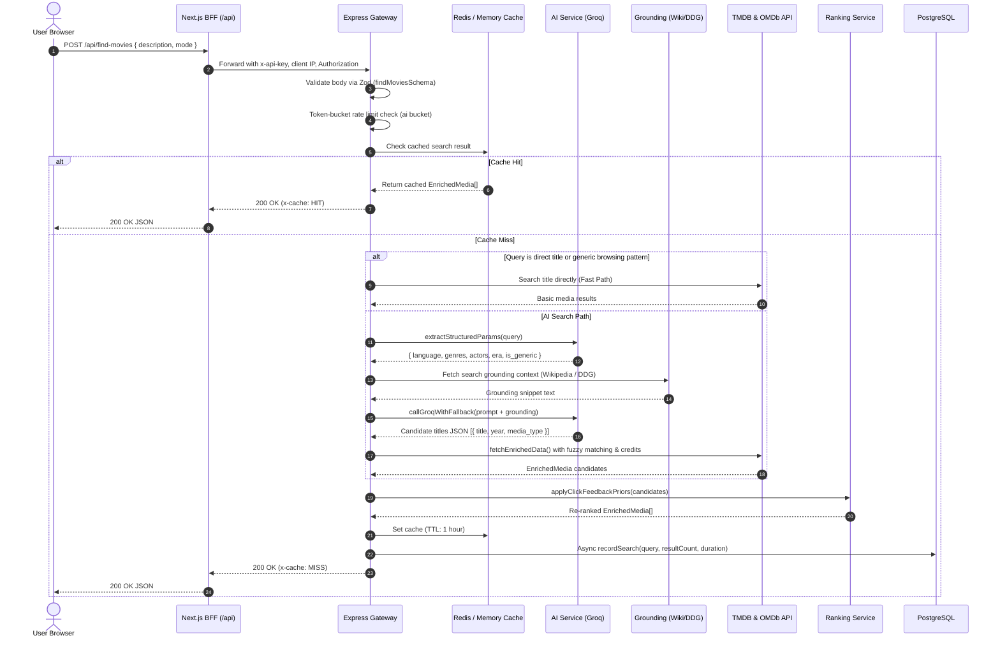
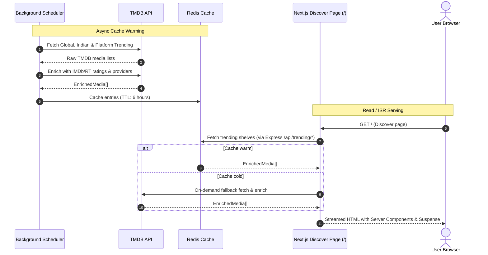
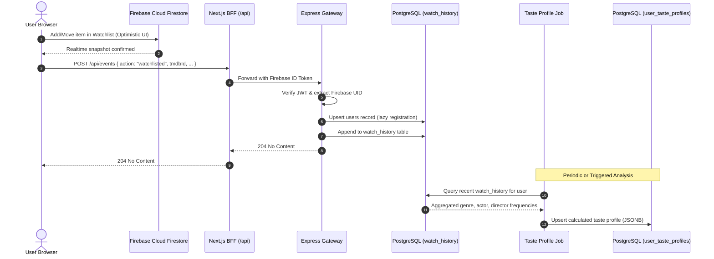
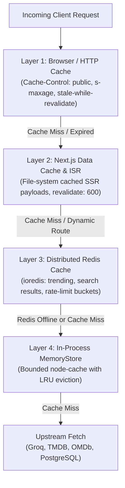
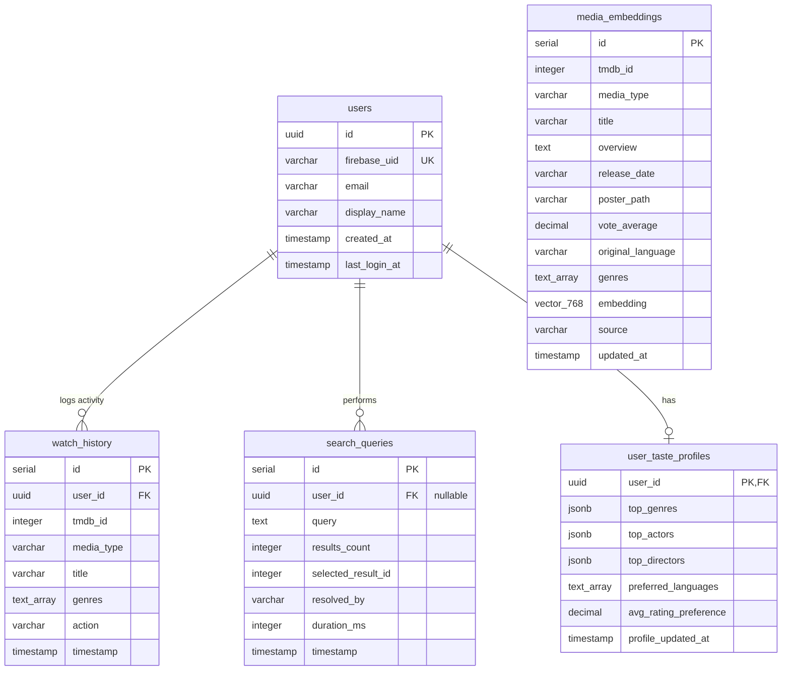
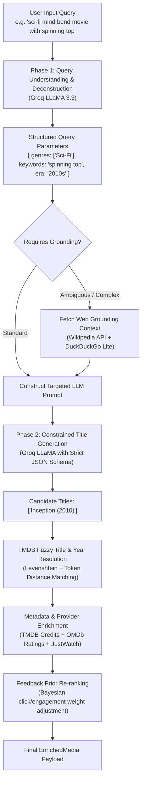

# CineBlaze — System Architecture

> **Comprehensive Technical Architecture Documentation**  
> Covers the full-stack system architecture across the Next.js App Router web application, Express API service, shared contracts, multi-tier caching, PostgreSQL + pgvector storage, AI/RAG grounding pipeline, and operational observability.

---

## 1. System Overview

**CineBlaze** is an AI-powered movie and television discovery platform designed to bridge the gap between vague human memory and concrete media metadata. Instead of requiring exact titles or relying strictly on keyword matching, CineBlaze enables users to discover entertainment using natural-language descriptions, complex plot fragments, emotional moods, actor pairings, and regional contexts.

### Core Capabilities

- **Hybrid Semantic Search**: Combines rule-based query parsing, structured parameter extraction via LLMs (Groq), grounded web context retrieval (TMDB, Wikipedia, DuckDuckGo Lite), and semantic vector similarity (`pgvector`).
- **Multi-State Kanban Watchlist**: Client-side interactive board ("Want to Watch", "Watching Now", "Watched") synchronized with Firebase Cloud Firestore in real time.
- **Taste-Based Personalization**: Implicit feedback loops capturing user clicks, searches, and watch actions in an append-only event stream, synthesized into offline taste profiles and dynamic "For You" recommendations.
- **Unified Media Enrichment**: Consolidates streaming availability (JustWatch/TMDB), multi-platform critical ratings (IMDb, Rotten Tomatoes, TMDB), trailers, runtimes, and season counts into a single payload.
- **Fail-Open Graceful Degradation**: Every infrastructure component (PostgreSQL, Redis, Firebase Auth, Sentry) is optional. If any layer fails or is omitted from the deployment, the platform degrades to in-process fallbacks without taking down core discovery.

---

## 2. High-Level Architecture

CineBlaze is structured as an npm-workspaces monorepo comprising three active packages (`web/`, `backend/`, and `shared/`), plus an archived reference client (`frontend/`).

```mermaid
flowchart TB
    subgraph Clients["Clients & Edge"]
        Browser["User Browser / Mobile Client"]
        VercelEdge["Vercel CDN / Edge Network"]
    end

    subgraph WebApp["Web Application — Next.js 16 (web/)"]
        BFF["BFF Route Handler<br/>/api/[...path]"]
        RSC["React Server Components<br/>/, /[mediaType]/[id], /search"]
        CSR["Client Islands<br/>Watchlist, SearchBar, Auth, SlidingRatings"]
        NextCache["Next.js Data Cache & ISR"]
    end

    subgraph Contract["Type Boundary (@cineblaze/shared)"]
        SharedTypes["TypeScript Interfaces & Type Guards<br/>EnrichedMedia, Request/Response Shapes, WatchlistItem"]
    end

    subgraph BackendAPI["Backend Service — Express (backend/)"]
        Gateway["Express Router & Security Middleware<br/>apiKey, auth, rateLimit, requestLogger"]
        SearchCtrl["searchController"]
        TrendingCtrl["trendingController"]
        PersonCtrl["personalizationController"]
        AISvc["aiService (Groq LLM)"]
        TMDBSvc["tmdbService & justWatchService"]
        RankSvc["rankingService (Feedback Priors)"]
        EmbedSvc["embeddingService (pgvector)"]
        Jobs["Background Cron Scheduler<br/>Taste Profiles & Cache Warming"]
    end

    subgraph DataStorage["Data & State Tier"]
        RedisStore["Redis 6+ (ioredis)<br/>Distributed Cache & Token Bucket"]
        MemStore["In-Process MemoryStore<br/>(Fail-open cache fallback)"]
        PostgresDB["PostgreSQL 16 + pgvector (Drizzle ORM)<br/>Users, Watch History, Queries, Taste Profiles, Embeddings"]
        Firestore["Firebase Cloud Firestore<br/>(Client Watchlist Realtime Sync)"]
        FirebaseAuth["Firebase Auth (Identity Provider)"]
    end

    subgraph ExternalAPIs["External Upstream Services"]
        GroqAPI["Groq LPU Cloud (LLaMA 3.3 / 3.1)"]
        TMDBAPI["The Movie Database (TMDB) API"]
        OMDbAPI["Open Movie Database (OMDb) API"]
        GroundingWeb["Grounding Sources: Wikipedia & DuckDuckGo Lite"]
    end

    %% Client Interactions
    Browser --> VercelEdge
    VercelEdge --> RSC
    VercelEdge --> CSR
    CSR -->|"Browser Fetch / sendBeacon"| BFF
    CSR <-->|"Firestore SDK Realtime Sync"| Firestore
    CSR <-->|"Firebase Auth SDK"| FirebaseAuth

    %% Web App Internal
    RSC --> NextCache
    RSC -->|"Direct Server Fetch with Secret"| Gateway
    BFF -->|"Proxy hop with x-api-key & client IP"| Gateway

    %% Shared Contract
    SharedTypes -.-> WebApp
    SharedTypes -.-> BackendAPI

    %% Backend Routing
    Gateway --> SearchCtrl
    Gateway --> TrendingCtrl
    Gateway --> PersonCtrl

    %% Controller to Services
    SearchCtrl --> AISvc
    SearchCtrl --> TMDBSvc
    SearchCtrl --> RankSvc
    SearchCtrl --> EmbedSvc
    TrendingCtrl --> TMDBSvc
    PersonCtrl --> PostgresDB
    Jobs --> PersonCtrl
    Jobs --> TMDBSvc

    %% Service to External
    AISvc --> GroqAPI
    AISvc --> GroundingWeb
    TMDBSvc --> TMDBAPI
    TMDBSvc --> OMDbAPI

    %% Caching & Storage
    Gateway <--> RedisStore
    Gateway <.-.-> MemStore
    SearchCtrl <--> RedisStore
    TrendingCtrl <--> RedisStore
    SearchCtrl --> PostgresDB
    EmbedSvc <--> PostgresDB
```

---

## 3. Component Breakdown

### 3.1 Web Application (`web/`)

- **Framework**: Next.js 16 (App Router) on Node 22, React 19, Tailwind CSS v4.
- **Backend-for-Frontend (BFF)**: Route handler at `src/app/api/[...path]/route.ts`. Eliminates browser-side CORS, injects the server-side shared secret (`INTERNAL_API_KEY`), and forwards client IP headers (`x-forwarded-for`) so Express rate limiting tracks real visitors.
- **Rendering Model**:
  - _Server Components (RSC)_: Used for discovery carousels, media detail pages, and search result scaffolding to generate static/streamed HTML with zero JavaScript overhead.
  - _Client Islands (CSR)_: Isolated to interactive controls (Kanban drag-and-drop board, search bar input, sliding ratings touch interactions, login form).
- **Error Handling & Observability**: Root error boundary (`global-error.tsx`) and route boundary (`error.tsx`) reporting to Sentry. Production Web Vitals reporting sink (`WebVitals.tsx`) transmitting CLS, FCP, FID, INP, LCP, and TTFB via `navigator.sendBeacon`.

### 3.2 Backend Service (`backend/`)

- **Runtime**: Node.js 22 with native ES Modules, TypeScript, and Express 4.
- **Validation**: Strict schema validation using Zod for all request bodies and route parameters (`middleware/validate.ts`).
- **Rate Limiting**: Dual-bucket token-bucket rate limiter (`middleware/rateLimit.ts`):
  - _AI Limiter_: Strict quota per window (default 30/hour) for compute-intensive Groq inferences.
  - _TMDB Limiter_: Abuse-prevention ceiling (default 300/hour) for cached metadata lookups.
  - _Storage_: Backed by Redis Lua scripts, falling back to local memory when Redis is absent.
- **Logging & Diagnostics**: Structured JSON logging via Pino with automatic redaction of API keys, tokens, and query credentials. `/health` and `/metrics` endpoints.

### 3.3 Shared Contract (`shared/`)

- **Package**: `@cineblaze/shared`.
- **Purpose**: Defines all data structures crossing the network boundary (`EnrichedMedia`, `WatchlistItem`, `FindMoviesRequest`, `MoviesResponse`, `UserEventRequest`, `MoodTag`, etc.).
- **Compilation**: Emits ESM JavaScript and TypeScript declaration files (`.d.ts`), compiled directly into both `web/` and `backend/` builds.

---

## 4. End-to-End Data Flow Diagrams

### 4.1 Search Request Lifecycle (`POST /api/find-movies`)



### 4.2 Trending & Platform Discovery Flow



### 4.3 Watchlist Sync & Personalization Event Bridge



---

## 5. Rendering & Delivery Strategy

| Route Segment       | Strategy                                  | Data Fetching & Caching                                                    | Revalidation                   |
| ------------------- | ----------------------------------------- | -------------------------------------------------------------------------- | ------------------------------ |
| `/` (Discover)      | **ISR (Incremental Static Regeneration)** | Fetches trending shelves via Server Components behind Suspense             | `revalidate: 600` (10 minutes) |
| `/search?q=&mode=`  | **SSR (Server-Side Rendering)**           | Dynamic server fetch from Express API, preserving query parameters         | Dynamic per request            |
| `/[mediaType]/[id]` | **SSR with Streaming**                    | Fetches media details, credits, ratings, and similar shelf; embeds JSON-LD | Dynamic with cache-aside       |
| `/watchlist`        | **CSR (Client-Side Rendering)**           | Gated behind Firebase Auth; real-time synchronization with Firestore       | Live WebSocket stream          |
| `/login`            | **CSR**                                   | Authentication forms (Email/Password, Google, Guest)                       | Static shell                   |
| `/settings`         | **CSR**                                   | Local browser preferences                                                  | Static shell                   |
| `/api/[...path]`    | **BFF Proxy Handler**                     | Server-to-server proxy with credential injection                           | `cache: "no-store"`            |

---

## 6. Multi-Tier Caching Architecture



1. **Layer 1 — Browser & Edge CDN**: Static assets (`_next/static`) cached immutably with 1-year max-age. Public pages leverage `stale-while-revalidate` HTTP directives.
2. **Layer 2 — Next.js Data Cache**: Pages using `generateMetadata` and `lib/server-api.ts` cache upstream responses across server component renders.
3. **Layer 3 — Redis Distributed Cache**:
   - Trending data: TTL 6 hours.
   - Search results: TTL 1 hour (keyed by lowercase normalized query).
   - Media details: TTL 24 hours.
   - Rate limit counters: Sliding 1-hour window.
4. **Layer 4 — In-Process Fallback (`MemoryStore`)**: Operates transparently when Redis is not configured or during connection failures. All cache calls use standard asynchronous interfaces (`get`, `set`, `del`, `has`, `invalidatePrefix`).

---

## 7. Security Architecture

- **Server-to-Server Authentication**: The Next.js BFF and Express API share an `INTERNAL_API_KEY`. Browser clients cannot inspect or forge this key.
- **User Identity Verification**: Firebase ID tokens (JWTs) are issued by Google Firebase Auth in the browser, passed via `Authorization: Bearer <token>`, and verified server-side using `jose` and Google's public JWKS keys.
- **Client IP Attribution**: The BFF forwards `x-forwarded-for` to Express. Express is configured with `app.set("trust proxy", true)` to ensure rate limiting isolates individual client IPs rather than throttling the Next.js server.
- **Defensive HTTP Headers**:
  - `Strict-Transport-Security: max-age=31536000; includeSubDomains; preload`
  - `X-Content-Type-Options: nosniff`
  - `X-Frame-Options: DENY`
  - `X-XSS-Protection: 1; mode=block`
  - `Referrer-Policy: strict-origin-when-cross-origin`
  - `Permissions-Policy: camera=(), microphone=(), geolocation=()`
  - `poweredByHeader: false` (removes fingerprinting)
- **Credential Scrubbing**: Custom regex scrubbers in Pino prevent API keys (`api_key=`, `token=`, `Bearer`) from appearing in server logs or external log drains.

---

## 8. Database Schema & Entity Relationships

The relational data tier uses **PostgreSQL 16** managed via **Drizzle ORM** with the `pgvector` extension for vector similarity search.



---

## 9. AI & Retrieval-Augmented Generation (RAG) Pipeline



---

## 10. Key Design Decisions & Trade-Offs

| Decision                                   | Rationale                                                                                                                      | Alternatives Considered                                    | Trade-Off Made                                                                  |
| ------------------------------------------ | ------------------------------------------------------------------------------------------------------------------------------ | ---------------------------------------------------------- | ------------------------------------------------------------------------------- |
| **Next.js BFF Route Handler**              | Keeps internal API secret on server; avoids browser CORS; unifies gateway.                                                     | Direct client-to-Express calls; Next.js rewrites.          | Added one internal network hop between Vercel and Render.                       |
| **Hybrid Firestore + Postgres**            | Firestore provides out-of-the-box WebSocket sync for mobile/web watchlists; Postgres provides SQL analytics and vector search. | Pure PostgreSQL with WebSockets; pure Firestore.           | Dual-write pattern bridged via asynchronous `/api/events` telemetry.            |
| **Shared Package (`@cineblaze/shared`)**   | Single source of truth for TypeScript contract. Compile errors prevent API drift before runtime.                               | Hand-synced interface files; OpenAPI/tRPC code generation. | Workspace monorepo compilation requires transpile step in Next.js config.       |
| **Graceful Degradation Model**             | App remains 100% operational for discovery and search even if Redis, Postgres, or Firebase are offline.                        | Hard dependency on all infrastructure services.            | Fallback code paths require testing both enabled and disabled states.           |
| **Token-Bucket Rate Limiting (Redis Lua)** | Atomic increments and window expiry in a single round-trip without race conditions.                                            | In-memory express-rate-limit; sliding-log window.          | Requires Redis for cluster coordination (falls back to local memory if absent). |
