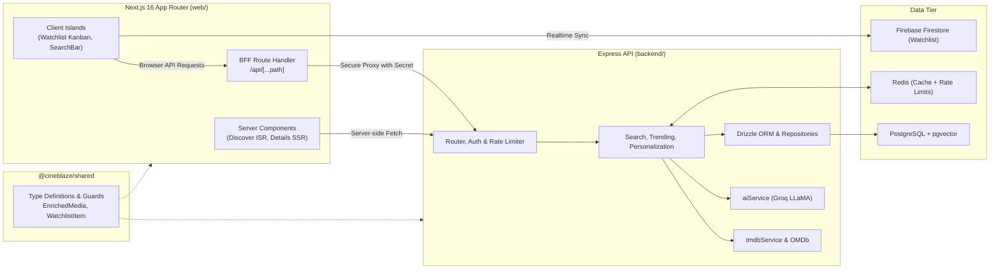

<h1 align="center">🔥 CineBlaze</h1>

<p align="center">
    <a href="https://github.com/SPGosavi/CineBlaze/actions/workflows/ci.yml"></a>
    
    
    
    
    
    
    
</p>

<h3 align="center">
    AI-Powered Semantic Movie & TV Series Discovery Platform
</h3>

<p align="center">
  CineBlaze bridges the gap between vague human memory and concrete media metadata. Users discover entertainment using natural-language descriptions, emotional moods, actor combinations, or plot fragments rather than rigid exact titles.
</p>

---

## 🚀 Live Demo & Deployment

- **Web Application**: [https://cine-blaze-movie-finder-web-app.vercel.app/](https://cine-blaze-movie-finder-web-app.vercel.app/)
- **Backend API**: Deployed on Render with zero-cold-start health checks.
- _Guest access is enabled by default. Natural-language search queries resolve in sub-seconds powered by Groq's high-throughput LPU inference._

---

## 💡 System Design Highlights

1. **Multi-Tier Caching Architecture**:
   - Four-level cache hierarchy: Browser/CDN $\to$ Next.js Data Cache & ISR $\to$ Distributed Redis cache $\to$ In-process memory fallback.
   - Transparent stale-while-revalidate (SWR) background refresh prevents cache stampedes on viral titles.
2. **Atomic Token-Bucket Rate Limiting**:
   - Backed by atomic Redis Lua scripts to throttle abuse while maintaining fair quotas.
   - Dual-bucket design: dedicated budget for high-compute Groq LLM queries (30/hr) and a generous ceiling for cached metadata lookups (300/hr).
3. **Retrieval-Augmented Generation (RAG) & Grounding Pipeline**:
   - Two-phase query understanding: decomposes natural language into structured constraints (`{ language, genres, actors, era }`), retrieves live grounding context from Wikipedia and DuckDuckGo Lite, and feeds a constrained JSON generation prompt to Groq.
   - Fuzzy matching with Levenshtein and token distance resolves LLM outputs to canonical TMDB records.
4. **Bayesian Click-Feedback Priors**:
   - Search result re-ranking incorporates historical user click and watchlist interactions to continually boost search relevance.
5. **Fail-Open Graceful Degradation**:
   - Every infrastructure dependency (Redis, PostgreSQL, Firebase Auth, Sentry, internal secret) is independently optional. If any backing service goes offline, the system degrades seamlessly without crashing or blocking core search.

---

## 🏗️ System Architecture

CineBlaze is architected as an npm-workspaces monorepo enforcing a strict TypeScript contract across all tiers:



> 📖 **Deep Dive Documentation**:
>
> - [ARCHITECTURE.md](ARCHITECTURE.md) — Comprehensive technical architecture, data flows, and infrastructure models.
> - [SYSTEM_DESIGN.md](SYSTEM_DESIGN.md) — System design interview specification (capacities, scalability, failure modes).
> - [BUNDLE_ANALYSIS.md](docs/BUNDLE_ANALYSIS.md) — Client bundle composition, chunk analysis, and tree-shaking metrics.
> - [BRANCH_PROTECTION.md](docs/BRANCH_PROTECTION.md) — Repository branch protection and CI enforcement policies.

---

## 🛠️ Tech Stack

### Web Application (`web/`)

- **Framework**: Next.js 16 (App Router, Server Components, Turbopack)
- **Language**: TypeScript 5
- **Styling**: Tailwind CSS v4
- **Icons**: Lucide React (tree-shaken named imports)
- **State & Real-time**: React 19 Contexts, Firebase Cloud Firestore SDK
- **Telemetry**: Sentry Next.js SDK, Core Web Vitals production sink (`navigator.sendBeacon`)

### Backend Service (`backend/`)

- **Runtime**: Node.js 22, Express 4, TypeScript (native ESM)
- **AI & RAG**: Groq Cloud SDK (LLaMA 3.3 70B & 3.1 8B), Wikipedia API, DuckDuckGo Lite
- **Metadata**: TMDB API (credits, providers, trailers), OMDb API (IMDb, Rotten Tomatoes)
- **Database & Vectors**: PostgreSQL 16, `pgvector`, Drizzle ORM
- **Cache & Throttling**: Redis 6+ (`ioredis`) with atomic Lua scripts, `node-cache` fallback
- **Validation & Reliability**: Zod schemas, Pino structured logging, Sentry error tracking

### Shared Package (`shared/`)

- `@cineblaze/shared` — Strict TypeScript types and type guards (`isMediaType`, `isSearchMode`, `isMoodTag`) shared across backend and frontend to eliminate runtime API contract drift.

---

## 🚀 Getting Started

### Prerequisites

- **Node.js**: `v22.19.0` or higher (see `.nvmrc`)
- **npm**: `v10+` (npm workspaces enabled)
- **API Keys**:
  - [Groq API Key](https://console.groq.com/)
  - [TMDB API Key](https://www.themoviedb.org/settings/api)
  - [OMDb API Key](https://www.omdbapi.com/apikey.aspx)
  - Firebase Project Configuration (optional for guest browsing)

### Local Setup

1. **Clone the repository and install dependencies**:

   ```bash
   git clone https://github.com/SPGosavi/CineBlaze.git
   cd CineBlaze
   npm install
   ```

2. **Configure environment variables**:

   ```bash
   # Root / Backend environment
   cp backend/.env.example backend/.env
   # Web environment
   cp web/.env.example web/.env.local
   ```

   _Only `GROQ_API_KEY`, `TMDB_API_KEY`, and `OMDB_API_KEY` are mandatory. All infrastructure services (Redis, Postgres, Firebase) fail open gracefully if omitted._

3. **Run the development environment**:

   ```bash
   npm run dev
   ```

   This concurrently launches:
   - `@cineblaze/shared` in TypeScript watch mode
   - `movie-finder-backend` on `http://localhost:5001`
   - `web` on `http://localhost:3000`

4. **(Optional) Run database migrations**:
   ```bash
   npm run db:migrate -w movie-finder-backend
   ```

---

## 🧪 Testing & Quality Assurance

The project enforces quality and performance gates automated via GitHub Actions CI:

```bash
# Run unit & integration tests across backend and web
npm test

# Run backend unit & integration tests with coverage
npm run test:backend

# Run web React component & hook tests with Vitest/JSDOM
npm run test:web

# Run end-to-end Playwright tests (Chromium, Firefox, Mobile Chrome)
npm run test:e2e

# Run typechecks across all workspaces
npm run typecheck

# Check and enforce formatting with Prettier
npm run format:check

# Run Webpack Bundle Analysis
npm run analyze:web

# Run automated Lighthouse CI audits
npm run lighthouse
```

---

## 🛡️ Infrastructure & Graceful Degradation

CineBlaze is designed so that no single auxiliary infrastructure service is a hard dependency:

| Service        | When Configured                                   | When Missing / Degraded                         | Health Check Status                   |
| -------------- | ------------------------------------------------- | ----------------------------------------------- | ------------------------------------- |
| **Redis**      | Distributed cache-aside & atomic rate limits      | In-memory `MemoryStore` cache; fail-open limits | `redis: "healthy"` vs `"disabled"`    |
| **PostgreSQL** | Search logging, taste profiles, vector embeddings | Search runs without history; events dropped     | `database: "healthy"` vs `"disabled"` |
| **Firebase**   | Cloud sync for Kanban watchlist                   | Guest search & detail viewing 100% active       | `auth: "healthy"` vs `"disabled"`     |
| **Sentry**     | Distributed exception tracing                     | Local console error logging                     | `sentry: "healthy"` vs `"disabled"`   |

Check the live runtime dependency status anytime via:

```bash
curl http://localhost:5001/health
```

---

## 📄 License

This project is licensed under the **MIT License**. Feel free to use, modify, and distribute with attribution.
