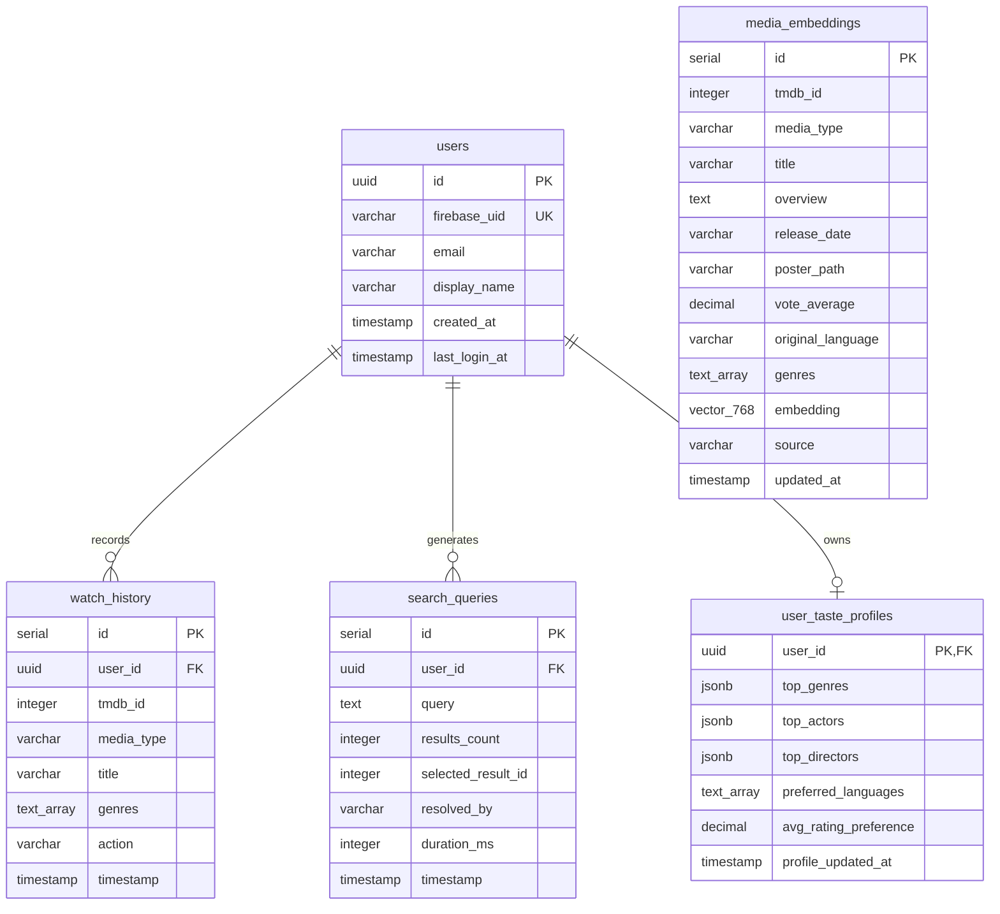

# CineBlaze — System Design Document

> **Capstone Technical Specification & Systems Architecture**  
> Formatted following industry-standard System Design Interview & Technical Architecture specifications.

---

## 1. Requirements

### 1.1 Functional Requirements

1. **Natural-Language Semantic Discovery**:
   - Users can search for movies and TV series using descriptive concepts, plot snippets, feelings, actor combinations, or cultural contexts (e.g. _"mind-bending thriller where reality is a simulation"_).
   - The system must support direct title lookups ("fast path") without incurring AI latency.
   - Support discovery modes: AI search, exact direct search, and mood/recommendation mode.
2. **Unified Media Enrichment**:
   - Provide comprehensive metadata for every title: synopses, cast, director, genres, release year, age ratings, runtime, and total season counts.
   - Aggregate critical consensus from multiple platforms: IMDb rating, Rotten Tomatoes Tomatometer percentage, and TMDB community score.
   - Display streaming provider availability (Netflix, Prime Video, Hotstar, JioCinema, etc.) with deep links.
3. **Interactive Multi-State Watchlist**:
   - Provide a 3-column Kanban interface ("Want to Watch", "Watching Now", "Watched") supporting drag-and-drop and touch-hold state transitions.
   - Support multi-device real-time state synchronization for authenticated users.
4. **Taste-Based Personalization**:
   - Automatically construct dynamic user taste profiles from search history, detail views, and watchlist additions.
   - Deliver a personalized "For You" shelf with recommendations that explain _why_ titles were recommended.
5. **Trending & Platform Curations**:
   - Surface trending content globally, regionally (Indian cinema), and across major streaming platforms.

### 1.2 Non-Functional Requirements

1. **Low Latency**:
   - Cached discovery & trending endpoints: $p95 < 80\text{ ms}$.
   - Direct title lookups: $p95 < 250\text{ ms}$.
   - Complex AI semantic search: $p95 < 3.0\text{ s}$ (end-to-end including LLM inference and enrichment).
2. **High Availability**:
   - $99.9\%$ uptime for discovery and search browsing.
3. **Zero-Single-Point-of-Failure (Graceful Degradation)**:
   - Inability to reach auxiliary services (PostgreSQL, Redis, Firebase, Sentry) must never crash the service or block search execution.
4. **Scalability & Cost Control**:
   - Protect expensive LLM inference budgets via dual-bucket token-bucket rate limiters.
   - Multi-tier caching to absorb repeat queries and traffic spikes.
5. **Security & Privacy**:
   - No sensitive API keys or credentials shipped to client browsers.
   - Scrub sensitive parameters (tokens, keys, authorization headers) from all logs.

---

## 2. Capacity Estimation & Calculations

### 2.1 Traffic Projections

- **Active User Base**:
  - Daily Active Users (DAU): $100{,}000$
  - Monthly Active Users (MAU): $1{,}000{,}000$
- **Request Volumes**:
  - Average user performs $5$ interactions per day (browsing trending shelves, searching, viewing details).
  - Total Daily Requests: $100{,}000 \times 5 = 500{,}000\text{ req/day}$.
  - Average Queries Per Second (QPS): $\frac{500{,}000}{86{,}400} \approx 6\text{ QPS}$.
  - Peak Traffic Factor ($5\times$): Peak QPS $\approx 30\text{ QPS}$.
  - Search QPS: ~20% of interactions = $1.2\text{ QPS}$ avg, $6\text{ QPS}$ peak.

### 2.2 Storage Estimations

1. **Search History (`search_queries`)**:
   - $100{,}000\text{ searches/day} \times 200\text{ bytes/row} = 20\text{ MB/day} \approx 7.3\text{ GB/year}$.
2. **Watch History Events (`watch_history`)**:
   - $50{,}000\text{ events/day} \times 250\text{ bytes/row} = 12.5\text{ MB/day} \approx 4.6\text{ GB/year}$.
3. **User Taste Profiles (`user_taste_profiles`)**:
   - $1{,}000{,}000\text{ users} \times 1.5\text{ KB/profile} \approx 1.5\text{ GB}$.
4. **Vector Embeddings (`media_embeddings`)**:
   - Catalog size: $100{,}000\text{ media titles}$.
   - 768-dimensional float32 vector: $768 \times 4\text{ bytes} \approx 3{,}072\text{ bytes} \approx 3.1\text{ KB}$.
   - Total Embedding Storage: $100{,}000 \times (3.1\text{ KB} + 1\text{ KB metadata}) \approx 410\text{ MB}$.

### 2.3 Cache Memory Sizing

- Top $20\%$ of searches and trending shelves serve $80\%$ of read volume (Pareto Principle).
- Active working set:
  - Trending items & platform shelves: ~10 MB.
  - Frequent search queries: $10{,}000\text{ queries} \times 15\text{ KB} \approx 150\text{ MB}$.
  - Total Redis cache footprint: $< 500\text{ MB}$, easily accommodated in standard Redis clusters.

---

## 3. High-Level Architecture Diagram

```mermaid
flowchart TB
    User["End User Client<br/>(Desktop / Mobile)"]

    subgraph CDN["Edge & Delivery Tier"]
        VercelCDN["Vercel Global Edge Network<br/>(Edge Caching, Compression, SSL)"]
    end

    subgraph AppTier["Application Presentation Tier (Next.js 16)"]
        BFF["BFF Proxy Route<br/>/api/[...path]"]
        RSC["React Server Components<br/>(Streaming HTML, Suspense)"]
        ClientIslands["Interactive Client Islands<br/>(Watchlist, Search, Ratings)"]
    end

    subgraph APITier["Compute & API Gateway Tier (Express)"]
        Router["Express API Router"]
        AuthMid["Auth Middleware (jose / Firebase JWT)"]
        RateMid["Token Bucket Rate Limiter (Redis Lua)"]
        Controllers["Search, Trending, Personalization Controllers"]
        Schedulers["Background Jobs (Cron / Tasks)"]
    end

    subgraph CacheTier["Caching Tier"]
        RedisCluster["Redis Cache & Token Bucket<br/>(ioredis)"]
        MemFallback["In-Process MemoryStore<br/>(Fail-Open Fallback)"]
    end

    subgraph StorageTier["Data Storage Tier"]
        Postgres["PostgreSQL 16 (Drizzle ORM)<br/>Users, Search Queries, Watch History, Taste Profiles"]
        PgVector["pgvector Extension<br/>(Cosine Semantic Search)"]
        FirestoreDB["Firebase Cloud Firestore<br/>(Realtime Watchlist Sync)"]
    end

    subgraph UpstreamTier["External Upstream Services"]
        Groq["Groq LPU Cloud (LLaMA 3.3)"]
        TMDB["TMDB API (Media Metadata)"]
        OMDb["OMDb API (Ratings Consensus)"]
        WebContext["Grounding Web Search (Wikipedia / DDG)"]
    end

    User <--> VercelCDN
    VercelCDN <--> AppTier
    ClientIslands <-->|"Firestore WebSocket Sync"| FirestoreDB
    BFF -->|"HTTP/2 with Internal Secret"| Router
    RSC -->|"Direct Server Fetch"| Router
    Router --> AuthMid --> RateMid --> Controllers
    Controllers <--> RedisCluster
    Controllers <.-.-> MemFallback
    Controllers --> Postgres
    Controllers --> PgVector
    Controllers --> UpstreamTier
    Schedulers --> Controllers
```

---

## 4. API Design & Data Contract

All API payloads conform strictly to the definitions published in `@cineblaze/shared`.

### 4.1 Key Endpoints

| Method | Endpoint                    | Description                                        | Auth Required        | Rate Limit Bucket |
| ------ | --------------------------- | -------------------------------------------------- | -------------------- | ----------------- |
| `POST` | `/api/find-movies`          | Natural language semantic discovery                | No (Optional JWT)    | AI (30/hr)        |
| `POST` | `/api/direct-search`        | Fast exact title lookup via TMDB                   | No                   | TMDB (300/hr)     |
| `POST` | `/api/get-similar`          | Contextual recommendation for title                | No                   | AI (30/hr)        |
| `GET`  | `/api/trending/:category`   | Trending media (`all`, `indian`, `platform/:name`) | No                   | TMDB (300/hr)     |
| `GET`  | `/api/media/:mediaType/:id` | Enriched media details by ID                       | No                   | TMDB (300/hr)     |
| `POST` | `/api/events`               | Record user interaction telemetry                  | Yes (Firebase Token) | TMDB (300/hr)     |
| `GET`  | `/api/for-you`              | Fetch personalized recommendations                 | Yes (Firebase Token) | TMDB (300/hr)     |
| `POST` | `/api/vitals`               | Ingest Web Vitals telemetry                        | No                   | None              |
| `GET`  | `/api/health`               | Service health & dependency status                 | No                   | None              |
| `GET`  | `/api/metrics`              | System operational metrics & latencies             | No                   | None              |

### 4.2 Data Shapes & Schema Validation

All requests are validated at runtime via **Zod** middleware:

```typescript
// Example: FindMoviesRequest Schema
export const findMoviesSchema = z.object({
  description: z.string().trim().min(1).max(500),
  mode: z.enum(["ai", "recommend"]).optional(),
});
```

---

## 5. Database Schema & Storage Architecture

### 5.1 Relational Schema (PostgreSQL + Drizzle ORM)



### 5.2 Key Indexes

- `watch_history`: Composite index on `(user_id, timestamp DESC)` for fast retrieval of recent activity; index on `(tmdb_id, media_type)` for title interest lookups.
- `search_queries`: Index on `(timestamp DESC)` for operational query monitoring and retrieval quality evaluations.
- `media_embeddings`: Unique index on `(tmdb_id, media_type)` to support upserts; cosine distance vector index (`HNSW` / `IVFFlat`) for sub-millisecond semantic search.

---

## 6. Multi-Tier Caching Architecture

| Cache Tier                | Storage Engine             | Invalidation Policy              | Data Held                                       | TTL                             |
| ------------------------- | -------------------------- | -------------------------------- | ----------------------------------------------- | ------------------------------- |
| **Tier 1: Edge CDN**      | Vercel Edge Cache          | Stale-While-Revalidate           | Static pages (`/`), JS/CSS bundles              | 10 mins (SWR 1 yr)              |
| **Tier 2: Next.js Cache** | Server Memory / ISR        | File-system ISR revalidation     | Pre-rendered Discover shelves                   | 10 minutes                      |
| **Tier 3: Distributed**   | Redis 6+ (ioredis)         | Time-based + Prefix invalidation | Trending shelves, Search results, Media details | 1 hr (Search), 6 hrs (Trending) |
| **Tier 4: In-Process**    | Node.js RAM (`node-cache`) | Memory-bounded LRU               | Upstream API fallback cache                     | 1 hour                          |

### Stampede & Dogpile Prevention

- Redis calls implement **stale-while-revalidate** patterns: when items approach expiry, background promises refresh the upstream data while currently serving stale entries to incoming requests.

---

## 7. AI & Machine Learning Pipeline

```mermaid
flowchart LR
    subgraph QueryIngestion["1. Query Analysis"]
        Raw["User Input"] --> GroqExtract["Groq LLM:<br/>extractStructuredParams"]
        GroqExtract --> Decomposed["{ genres, actors, keywords, era }"]
    end

    subgraph ContextRetrieval["2. Grounding & Search"]
        Decomposed --> Grounding{"Grounding Needed?"}
        Grounding -->|Yes| WebGround["Wikipedia & DDG Lite"]
        Grounding -->|No| DirectLLM["Direct Prompt"]
        WebGround --> DirectLLM
    end

    subgraph LLMInference["3. Constrained Inference"]
        DirectLLM --> LlamaGen["Groq LLaMA 3.3 (JSON Schema)"]
        LlamaGen --> Candidates["Raw Titles List"]
    end

    subgraph Enrichment["4. Enrichment & Priors"]
        Candidates --> FuzzyTMDB["TMDB Fuzzy Match"]
        FuzzyTMDB --> OMDb["OMDb Critical Ratings"]
        OMDb --> PriorRank["Bayesian Click-Feedback Priors"]
        PriorRank --> Final["Ranked EnrichedMedia[]"]
    end
```



1. **Query Decomposition**: Extracts explicit filters (language, genre, release era) from natural language to avoid hallucinated recommendations.
2. **Context Grounding**: Pulls relevant entity summaries from Wikipedia and DuckDuckGo Lite to inform the prompt with current, factually accurate context.
3. **Fuzzy Resolution**: Matches LLM text output against canonical TMDB records using Levenshtein distance and token similarity algorithms.
4. **Click Feedback Priors**: Dynamically boosts ranking scores for items that historical searchers have clicked or added to watchlists for similar queries.

---

## 8. Scalability & Growth Engineering

### Scaling from $1\times$ to $10\times$ (100K to 1M DAU)

- **Stateless Application Servers**: Express API instances can be scaled horizontally behind a round-robin load balancer.
- **PostgreSQL Read Replicas**: Separate analytical queries (taste profile recomputations) from transactional writes (`watch_history`).
- **Redis Cluster**: Shard Redis keys by slot to distribute memory across multiple nodes.

### Scaling to $100\times$ (10M DAU)

- **Asynchronous Event Ingestion**: Decouple `/api/events` telemetry from synchronous Express writes using Apache Kafka or AWS SQS.
- **Dedicated Embedding Search Cluster**: Migrate vector search from in-database `pgvector` to managed vector databases (Pinecone, Milvus, or Qdrant) for high-dimensional nearest-neighbor retrieval at scale.

---

## 9. Failure Modes & Graceful Degradation

| Failure Mode              | Direct Impact                        | System Recovery / Degradation Mechanism                                                                                                                    |
| ------------------------- | ------------------------------------ | ---------------------------------------------------------------------------------------------------------------------------------------------------------- |
| **Groq LLM 429 / Outage** | AI search cannot execute             | Retries with exponential backoff $\to$ falls back to secondary Groq model $\to$ falls back to keyword-extracted direct TMDB search.                        |
| **Redis Offline**         | Distributed cache unavailable        | Express logs warning and instantly routes all cache reads/writes to local in-memory `MemoryStore`. Rate limiter fails open.                                |
| **PostgreSQL Offline**    | History & taste profiles unavailable | Search and discovery continue uninterrupted; telemetry logging silently drops events without throwing 500 errors to clients.                               |
| **TMDB API Latency**      | Media enrichment stalls              | Requests execute under a strict `AbortController` timeout budget ($15\text{ s}$ standard, $120\text{ s}$ AI). Graceful fallback to cached representations. |
| **Firebase Unconfigured** | User login unavailable               | Full discovery, search, and detail experiences remain accessible to guest users; watchlist displays clear configuration warning.                           |

---

## 10. Monitoring, Observability & Alerting

1. **Structured Logging (Pino)**:
   - Emits NDJSON with standard fields (`level`, `time`, `component`, `req.id`).
   - PII and credential sanitization enabled via automated regex scrubbers.
2. **Distributed Tracing & Error Capture (Sentry)**:
   - Captures client and server exceptions with error digests and stack traces.
3. **Synthetic Health Checks (`GET /api/health`)**:
   - Inspects live connectivity to Redis, PostgreSQL, and upstream API keys.
   - Accurately differentiates **disabled** states (intentional dev configuration) from **degraded** states (runtime outage).
4. **Real User Monitoring (Web Vitals)**:
   - Tracks Core Web Vitals (LCP, FID, CLS, TTFB, INP) across production traffic using `navigator.sendBeacon` and logs them directly through the backend telemetry pipeline.
