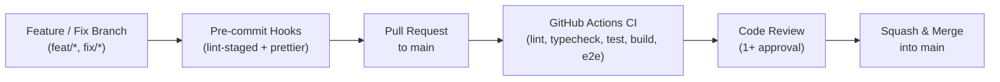

# Branch Protection & Pull Request Policy

This document defines the recommended GitHub branch protection rules and merging standards for the `main` branch of the CineBlaze repository.

---

## 1. Branch Protection Rules for `main`

To ensure code stability, auditability, and production readiness, configure the following rules on GitHub under **Settings → Branches → Add branch ruleset / protection rule** targeting `main`:

### A. Require a Pull Request Before Merging

- **Require approvals**: At least **1 review approval** before merging.
- **Dismiss stale pull request approvals when new commits are pushed**: Enabled. Any modification after review requires re-review.
- **Require review from Code Owners**: Optional (recommended when code ownership is established).
- **Require conversation resolution before merging**: Enabled. All PR review comments must be resolved before landing.

### B. Require Status Checks to Pass Before Merging

Enable **"Require status checks to pass before merging"** and check **"Require branches to be up to date before merging"** (strict mode).

Require the following status checks (matching `.github/workflows/ci.yml` jobs):

1. **`Lint & Format Check`**:
   - `npm run format:check` (Prettier)
   - `npm run lint` (ESLint across web and frontend)
2. **`TypeScript Check`**:
   - `npm run typecheck` (`tsc --noEmit` across shared, backend, and web)
3. **`Unit & Integration Tests`**:
   - `npm run test:ci` (Vitest with v8 coverage across backend and web)
4. **`Build Workspaces`**:
   - `npm run build` (tsc shared, tsc backend, Next.js optimized production build)
   - Verification of `backend/dist` and `web/.next`
5. **`Playwright E2E Tests`**:
   - `npm run test:e2e` (Chromium, Firefox, Mobile Chrome critical flow verification)

### C. Direct Push Restrictions

- **Do not allow bypassing the above settings**: Enabled (enforced for administrators as well).
- **Block force pushes**: Enabled (`Allow force pushes` unchecked).
- **Block branch deletions**: Enabled (`Allow deletions` unchecked).

---

## 2. Development Workflow Summary



1. **Branch Naming**:
   - `feat/<feature-name>` for features
   - `fix/<issue-name>` for bug fixes
   - `chore/<task-name>` for tooling / documentation
2. **Local Verification**:
   Before opening a PR, ensure local checks pass:
   ```bash
   npm run format:check
   npm run lint
   npm run typecheck
   npm test
   npm run build
   ```
3. **Merging Strategy**:
   - Prefer **Squash and merge** with a conventional commit message (`feat(...)`, `fix(...)`, `chore(...)`) to keep a clean, linear git history on `main`.
